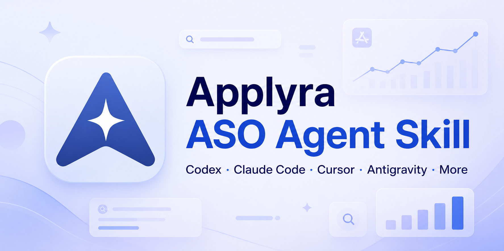

<p align="center"></p>

<h1 align="center">Applyra ASO Agent Skill</h1>

<p align="center">ASO basado en evidencia para Apple App Store y Google Play.<br><a href="README.md">English</a></p>

## Qué hace

Este [Agent Skill](https://agentskills.io/specification) standalone ayuda a
Codex, Claude Code y agentes compatibles con investigación de keywords,
rankings, competidores, metadata validada, auditorías ASO Health, simulación de
borradores, localización, creatividades y medición de cambios con notas y
comparaciones de eventos usando datos de Applyra.

Incluye rutas breves para consultas puntuales, objetivos y recursos del negocio,
comparación de paquetes de metadata, análisis de reseñas, seguimiento de cambios
de competidores, briefs de iconos y previews, calendarios estacionales y briefs
de In-App Events. Las reseñas y las métricas propias de conversión/ingresos
necesitan una fuente disponible o una exportación. Los planes no publican ni
programan tareas por sí solos.

## Ejemplos de uso

```text
Comprueba solo este título iOS y su longitud, sin una auditoría completa.
Compara dos paquetes de metadata protegiendo mis keywords actuales.
Analiza esta exportación de reseñas y redacta respuestas con fixes verificados.
Compara estas capturas fechadas de competidores y señala los cambios observados.
Prepara un test de iconos y un storyboard localizado con pantallas reales.
Planifica una campaña estacional para España con caducidad y reversión.
```

Empieza en modo de solo lectura. La investigación puede consumir cuota y guardar
historial; cambiar apps, keywords, competidores o notas, publicar metadata y
ejecutar operaciones Git requiere autorización explícita.

## Requisitos

- para investigación ASO en vivo, una cuenta de Applyra: tanto Free como Unlimited permiten API/MCP;
- OAuth remoto en `https://www.applyra.io/api/mcp`, o stdio local con Node.js 20+, `APPLYRA_API_KEY` y `@applyra/mcp-server@1.8.0`;
- Python 3 para el validador de metadata incluido.

La revisión de textos aportados, las exportaciones de reseñas y los briefs de
creatividades pueden trabajarse sin conectar Applyra.

Free incluye 50 peticiones API al mes y siete días de historial; cada llamada
a una herramienta cuenta como una petición. Unlimited incluye 10.000 peticiones
API al mes. La skill adapta lecturas e investigación al saldo real de la cuenta.
Consulta los [planes y límites de Applyra](https://www.applyra.io/docs/account/plans-and-limits).

## Conseguir acceso a Applyra

1. Antes de registrarte, [abre Applyra con el enlace referido de LuchoLabs](https://www.applyra.io/?ref=8BA10079167B)
   y crea tu cuenta desde allí.
2. Puedes empezar en **Free**, que ya incluye API y MCP. Unlimited es opcional
   para mayores cuotas e historial.
3. Conecta mediante OAuth remoto u obtén `APPLYRA_API_KEY` desde tu cuenta
   para la instalación local de MCP que aparece debajo.

> **Ventaja del referido:** obtienes un **50 % de descuento en tu primer mes de
> Unlimited**. Si continúas durante el segundo mes, LuchoLabs recibe **un mes
> gratis de Unlimited** como crédito de Applyra; las recompensas no tienen valor
> en efectivo. Consulta las [condiciones vigentes del programa](https://www.applyra.io/#faq).
> Este proyecto comunitario independiente no es un repositorio oficial de Applyra.

## Instalación rápida — todos los agentes compatibles

El CLI transversal [`skills`](https://github.com/vercel-labs/skills) detecta
los clientes instalados y permite elegir alcance y destinos:

```bash
npx skills add lucholabs/applyra-aso-skill --skill applyra-aso
```

Para instalar globalmente en todos los clientes compatibles detectados:

```bash
npx skills add lucholabs/applyra-aso-skill \
  --skill applyra-aso --agent '*' --global --copy --yes
```

## Clientes compatibles

| Cliente | Ruta personal/global | Ruta de proyecto | Invocar o comprobar |
|---|---|---|---|
| Codex | `~/.agents/skills/applyra-aso` | `.agents/skills/applyra-aso` | `$applyra-aso` o `/skills` |
| Claude Code | `~/.claude/skills/applyra-aso` | `.claude/skills/applyra-aso` | `/applyra-aso` |
| Cursor | `~/.cursor/skills/applyra-aso` o `~/.agents/skills/applyra-aso` | `.cursor/skills/applyra-aso` o `.agents/skills/applyra-aso` | `/applyra-aso` |
| Google Antigravity | `~/.gemini/config/skills/applyra-aso` | `.agents/skills/applyra-aso` | pedir la lista de skills |
| Antigravity CLI | `~/.gemini/antigravity-cli/skills/applyra-aso` | `.agents/skills/applyra-aso` | `/skills` |
| Gemini CLI | `~/.gemini/skills/applyra-aso` o `~/.agents/skills/applyra-aso` | `.gemini/skills/applyra-aso` o `.agents/skills/applyra-aso` | `/skills list` |
| GitHub Copilot | `~/.copilot/skills/applyra-aso` o `~/.agents/skills/applyra-aso` | `.github/skills/applyra-aso` o `.agents/skills/applyra-aso` | `/applyra-aso` |
| Windsurf | `~/.codeium/windsurf/skills/applyra-aso` o `~/.agents/skills/applyra-aso` | `.windsurf/skills/applyra-aso` o `.agents/skills/applyra-aso` | `@applyra-aso` |
| OpenCode | `~/.config/opencode/skills/applyra-aso` o `~/.agents/skills/applyra-aso` | `.opencode/skills/applyra-aso` o `.agents/skills/applyra-aso` | automático o selector |
| Otros clientes Agent Skills | elegido por `npx skills` | normalmente `.agents/skills/applyra-aso` | selector del cliente |

El instalador universal también soporta Cline, Roo Code, Amp, Goose, Warp, Zed,
Replit, Continue, Devin, OpenHands, Kiro y otros clientes Agent Skills. Sus rutas
nativas cambian más, por lo que conviene dejar que el instalador elija el
destino vigente.

## Instalar en Codex

El flujo estándar es pedirle al instalador incluido en Codex que lo instale. No
hace falta ejecutar Python. Dentro de Codex escribe:

```text
$skill-installer instala applyra-aso desde lucholabs/applyra-aso-skill, ruta applyra-aso
```

Codex instala los skills personales en `~/.agents/skills`. Si no aparece,
reinicia Codex y ejecútalo con `$applyra-aso`.

Para un solo proyecto, copia `applyra-aso/` a
`.agents/skills/applyra-aso/` dentro de ese repositorio.

## Instalar en Claude Code

```bash
git clone --depth 1 https://github.com/lucholabs/applyra-aso-skill.git
mkdir -p ~/.claude/skills
cp -R applyra-aso-skill/applyra-aso ~/.claude/skills/applyra-aso
```

Abre Claude Code y ejecuta `/applyra-aso`. Para un solo proyecto, copia la
carpeta a `.claude/skills/applyra-aso/` dentro de ese proyecto.

## Conectar Applyra MCP

### OAuth remoto

Añade `https://www.applyra.io/api/mcp` como servidor MCP remoto Streamable HTTP
en un cliente compatible con OAuth e inicia sesión en Applyra. Esta opción no
necesita Node.js ni una API key local. Puedes revocar las conexiones desde el
[panel MCP de Applyra](https://www.applyra.io/dashboard/mcp). Consulta la
[guía oficial de conexión](https://www.applyra.io/docs/api/mcp-server).

### Stdio local

Exporta la clave en el shell que abre el agente; nunca la guardes en Git:

```bash
export APPLYRA_API_KEY="tu-clave"
```

Codex (`~/.codex/config.toml`):

```toml
[mcp_servers.applyra]
command = "npx"
args = ["-y", "@applyra/mcp-server@1.8.0"]
env_vars = ["APPLYRA_API_KEY"]
```

Claude Code:

```bash
claude mcp add --transport stdio --scope user applyra -- \
  npx -y @applyra/mcp-server@1.8.0
```

Abre Claude Code desde el shell donde exportaste la clave y comprueba `/mcp`.

En Cursor, Antigravity, Gemini CLI, GitHub Copilot, Windsurf, OpenCode y otros
clientes MCP, añade un servidor local **stdio** desde sus ajustes MCP:

```text
nombre: applyra
comando: npx
argumentos: -y @applyra/mcp-server@1.8.0
variable de entorno: APPLYRA_API_KEY (heredada del shell que abre el cliente)
```

## Verificar

```bash
python3 applyra-aso/scripts/validate_metadata.py --self-test
python3 -m unittest discover -s applyra-aso/scripts/tests -p 'test_*.py'
# Solo para stdio local; OAuth no necesita Node.js ni APPLYRA_API_KEY.
bash applyra-aso/scripts/check_setup.sh
```

Python ejecuta la validación de metadata y las comprobaciones del paquete;
no es el instalador de Codex.

La skill pasa a la versión **1.4.0**. Los contratos de Applyra se revisaron el
**02-11-2026** con MCP **1.8.0**. Esta versión incorpora rutas por intención,
contexto comercial y los nuevos flujos de comparación, reseñas, seguimiento,
creatividades y campañas. Se mantiene la validación UTF-16 y el límite de
**100 caracteres** en keywords iOS. Las pruebas locales comprueban enlaces,
versiones y fixtures; los [escenarios de comportamiento](applyra-aso/evals/README.md)
se evalúan por separado. La suite no necesita acceder a una cuenta real.

## Actualizar o desinstalar

```bash
npx skills update applyra-aso --global
npx skills remove applyra-aso --global
```

## Documentación oficial

- [Documentación de Applyra](https://www.applyra.io/docs)
- [Applyra MCP: 30 herramientas](https://www.applyra.io/docs/api/mcp-tools)
- [ASO Health de Applyra](https://www.applyra.io/docs/concepts/aso-health)
- [Simulador de metadata de Applyra](https://www.applyra.io/docs/tools/metadata-simulator)
- [Notas y eventos de Applyra](https://www.applyra.io/docs/applications/notes-and-events)
- [OpenAI: crear skills](https://developers.openai.com/codex/skills)
- [Claude Code: skills](https://code.claude.com/docs/en/skills)
- [Cursor: Agent Skills](https://cursor.com/docs/skills)
- [Google Antigravity: Agent Skills](https://codelabs.developers.google.com/getting-started-with-antigravity-skills)
- [Gemini CLI: Agent Skills](https://geminicli.com/docs/cli/using-agent-skills/)
- [GitHub Copilot: Agent Skills](https://docs.github.com/en/copilot/concepts/agents/about-agent-skills)
- [Windsurf: Cascade Skills](https://docs.windsurf.com/es/windsurf/cascade/skills)
- [OpenCode: Agent Skills](https://opencode.ai/docs/skills)
- [Especificación Agent Skills](https://agentskills.io/specification)

## Licencia

MIT. Este proyecto comunitario independiente no es un repositorio oficial de
Applyra.
