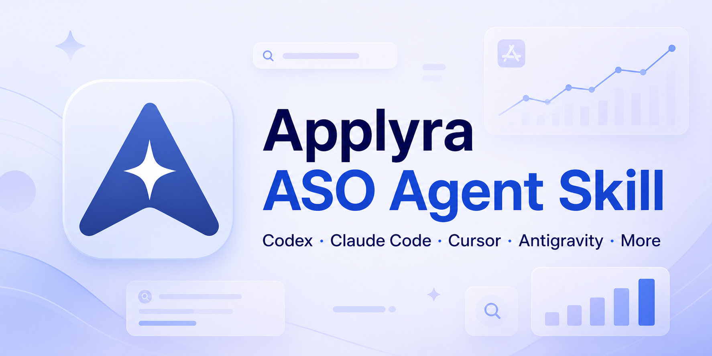

<p align="center"></p>

<h1 align="center">Applyra ASO Agent Skill</h1>

<p align="center">Evidence-led App Store Optimization for Apple App Store and Google Play.<br><a href="README.es.md">Español</a></p>

## What it does

This standalone [Agent Skill](https://agentskills.io/specification) helps Codex,
Claude Code, and compatible agents with:

- keyword research, rankings, traffic, difficulty, and KEI;
- competitor and market-gap analysis;
- validated App Store and Google Play metadata, ASO Health audits and draft simulation;
- localization, screenshot briefs, and conversion experiments;
- chart notes, event comparisons, and measurable keep/iterate/rollback plans.
- focused routes for single-field questions and comparable metadata candidates;
- review-export analysis, rating strategy, dated competitor comparisons;
- icon/preview briefs, local seasonal calendars, and In-App Event briefs.

Reviews and first-party store/product analytics need an available source or export;
Applyra supplies ASO metrics. Briefs and calendars do not publish or schedule work.

## Example requests

```text
Check only this iOS title and its character count; no full audit.
Compare two metadata packages while protecting my existing keyword phrases.
Analyze this review export and draft replies backed by verified fixes.
Compare these competitor snapshots and list only observable changes.
Brief an icon test and a localized app-preview storyboard using my real UI.
Plan a seasonal campaign for Spain with expiry dates and rollback values.
```

It starts read-only. Budgeted research may consume allowance and save history;
changes to tracked apps, keywords, competitors or notes, store publication, and
Git operations require explicit authorization.

## Requirements

- for live ASO research, an Applyra account: Free and Unlimited both support API/MCP;
- hosted OAuth at `https://www.applyra.io/api/mcp`, or local stdio with Node.js 20+, `APPLYRA_API_KEY`, and `@applyra/mcp-server@1.8.0`;
- Python 3 for the bundled metadata validator.

Supplied-copy checks, review exports and asset briefs can run without Applyra.

Free includes 50 API requests/month and seven days of history; every tool call
counts as one request. Unlimited includes 10,000 API requests/month. The skill
budgets reads and research against the account’s actual remaining allowance.
See [Applyra’s plans and limits](https://www.applyra.io/docs/account/plans-and-limits).

## Get Applyra access

1. Before signing up, [open Applyra through the LuchoLabs referral link](https://www.applyra.io/?ref=8BA10079167B),
   then create your account.
2. Start on **Free**, which includes API and MCP access. Unlimited is optional
   for larger allowances and longer history.
3. Connect through hosted OAuth, or get `APPLYRA_API_KEY` from your Applyra
   account for the local MCP installation below.

> **Referral benefit:** You get **50% off your first Unlimited month**. If you
> stay for month two, LuchoLabs gets **one free Unlimited month** as Applyra
> credit; rewards have no cash value. See [Applyra's current referral terms](https://www.applyra.io/#faq).
> This independent community project is not an official Applyra repository.

## Quick install — all supported agents

The cross-agent [`skills` CLI](https://github.com/vercel-labs/skills) detects
installed clients and lets you choose the scope and targets interactively:

```bash
npx skills add lucholabs/applyra-aso-skill --skill applyra-aso
```

To install globally into every compatible client detected on your machine:

```bash
npx skills add lucholabs/applyra-aso-skill \
  --skill applyra-aso --agent '*' --global --copy --yes
```

Review third-party skills before installing them. This repository contains one
skill and its source is fully visible under [`applyra-aso/`](applyra-aso/).

## Supported clients

| Client | Personal/global location | Project location | Invoke or verify |
|---|---|---|---|
| Codex | `~/.agents/skills/applyra-aso` | `.agents/skills/applyra-aso` | `$applyra-aso` or `/skills` |
| Claude Code | `~/.claude/skills/applyra-aso` | `.claude/skills/applyra-aso` | `/applyra-aso` |
| Cursor | `~/.cursor/skills/applyra-aso` or `~/.agents/skills/applyra-aso` | `.cursor/skills/applyra-aso` or `.agents/skills/applyra-aso` | `/applyra-aso` |
| Google Antigravity | `~/.gemini/config/skills/applyra-aso` | `.agents/skills/applyra-aso` | ask for available skills |
| Antigravity CLI | `~/.gemini/antigravity-cli/skills/applyra-aso` | `.agents/skills/applyra-aso` | `/skills` |
| Gemini CLI | `~/.gemini/skills/applyra-aso` or `~/.agents/skills/applyra-aso` | `.gemini/skills/applyra-aso` or `.agents/skills/applyra-aso` | `/skills list` |
| GitHub Copilot | `~/.copilot/skills/applyra-aso` or `~/.agents/skills/applyra-aso` | `.github/skills/applyra-aso` or `.agents/skills/applyra-aso` | `/applyra-aso` |
| Windsurf | `~/.codeium/windsurf/skills/applyra-aso` or `~/.agents/skills/applyra-aso` | `.windsurf/skills/applyra-aso` or `.agents/skills/applyra-aso` | `@applyra-aso` |
| OpenCode | `~/.config/opencode/skills/applyra-aso` or `~/.agents/skills/applyra-aso` | `.opencode/skills/applyra-aso` or `.agents/skills/applyra-aso` | automatic or skill picker |
| Other Agent Skills clients | selected by `npx skills` | usually `.agents/skills/applyra-aso` | client-specific picker |

The universal installer also supports Cline, Roo Code, Amp, Goose, Warp, Zed,
Replit, Continue, Devin, OpenHands, Kiro, and other Agent Skills clients. Their
native paths change more often, so let the installer select the current target.

## Install in Codex

The standard Codex flow is to ask its bundled skill installer—no Python command
is required. In Codex, enter:

```text
$skill-installer install applyra-aso from lucholabs/applyra-aso-skill, path applyra-aso
```

Codex installs user skills under `~/.agents/skills`. If it does not appear,
restart Codex, then invoke it with `$applyra-aso`.

For one repository only, copy `applyra-aso/` to
`.agents/skills/applyra-aso/` in that repository.

## Install in Claude Code

Claude Code discovers personal skills under `~/.claude/skills`:

```bash
git clone --depth 1 https://github.com/lucholabs/applyra-aso-skill.git
mkdir -p ~/.claude/skills
cp -R applyra-aso-skill/applyra-aso ~/.claude/skills/applyra-aso
```

Start Claude Code and run `/applyra-aso`. For one project only, copy the folder
to `.claude/skills/applyra-aso/` in that project.

## Connect Applyra MCP

### Hosted OAuth

Add `https://www.applyra.io/api/mcp` as a remote Streamable HTTP MCP server
in an OAuth-capable client and sign in to Applyra. This path needs no local
Node.js or API key. Connected assistants can be revoked from the
[Applyra MCP dashboard](https://www.applyra.io/dashboard/mcp). See the
[official connection guide](https://www.applyra.io/docs/api/mcp-server).

### Local stdio

Export the key in the shell that launches your agent. Do not put it in Git:

```bash
export APPLYRA_API_KEY="your-key"
```

Codex (`~/.codex/config.toml`):

```toml
[mcp_servers.applyra]
command = "npx"
args = ["-y", "@applyra/mcp-server@1.8.0"]
env_vars = ["APPLYRA_API_KEY"]
```

Claude Code:

```bash
claude mcp add --transport stdio --scope user applyra -- \
  npx -y @applyra/mcp-server@1.8.0
```

Launch Claude Code from the shell where `APPLYRA_API_KEY` is exported, then use
`/mcp` to verify the connection.

For Cursor, Antigravity, Gemini CLI, GitHub Copilot, Windsurf, OpenCode, and
other MCP clients, add a local **stdio** server in the client's MCP settings:

```text
name: applyra
command: npx
arguments: -y @applyra/mcp-server@1.8.0
environment variable: APPLYRA_API_KEY (inherit it from the launching shell)
```

## Verify

```bash
python3 applyra-aso/scripts/validate_metadata.py --self-test
python3 -m unittest discover -s applyra-aso/scripts/tests -p 'test_*.py'
# Local stdio only; OAuth does not need Node.js or APPLYRA_API_KEY.
bash applyra-aso/scripts/check_setup.sh
```

Python runs the bundled metadata validator and offline package checks. It is
not the Codex installer.

The skill is version **1.4.0**. Applyra contracts were reviewed on **2026-11-02**
against MCP **1.8.0**. This release adds intent routing, business goals, candidate
comparison, reviews, monitoring, creative briefs, and seasonal/event planning.
Metadata validation retains UTF-16 counting, including the **100-character** iOS
keyword field. Offline package checks cover resource links, versions and fixtures;
[behavior scenarios](applyra-aso/evals/README.md) are evaluated separately from
those deterministic checks. No live account access is needed to run the suite.

## Update or uninstall

```bash
npx skills update applyra-aso --global
npx skills remove applyra-aso --global
```

## Structure

```text
applyra-aso/
├── SKILL.md
├── agents/openai.yaml
├── assets/
├── evals/
├── references/
└── scripts/
```

## Documentation

- [Applyra documentation](https://www.applyra.io/docs)
- [Applyra MCP: 30 tools](https://www.applyra.io/docs/api/mcp-tools)
- [Applyra ASO Health](https://www.applyra.io/docs/concepts/aso-health)
- [Applyra Metadata Simulator](https://www.applyra.io/docs/tools/metadata-simulator)
- [Applyra notes and events](https://www.applyra.io/docs/applications/notes-and-events)
- [OpenAI: Build skills](https://developers.openai.com/codex/skills)
- [Claude Code: Extend Claude with skills](https://code.claude.com/docs/en/skills)
- [Cursor: Agent Skills](https://cursor.com/docs/skills)
- [Google Antigravity: Agent Skills](https://codelabs.developers.google.com/getting-started-with-antigravity-skills)
- [Gemini CLI: Manage Agent Skills](https://geminicli.com/docs/cli/using-agent-skills/)
- [GitHub Copilot: Agent Skills](https://docs.github.com/en/copilot/concepts/agents/about-agent-skills)
- [Windsurf: Cascade Skills](https://docs.windsurf.com/windsurf/cascade/skills)
- [OpenCode: Agent Skills](https://opencode.ai/docs/skills)
- [Agent Skills specification](https://agentskills.io/specification)

## License

MIT. This independent community project is not an official Applyra repository.
